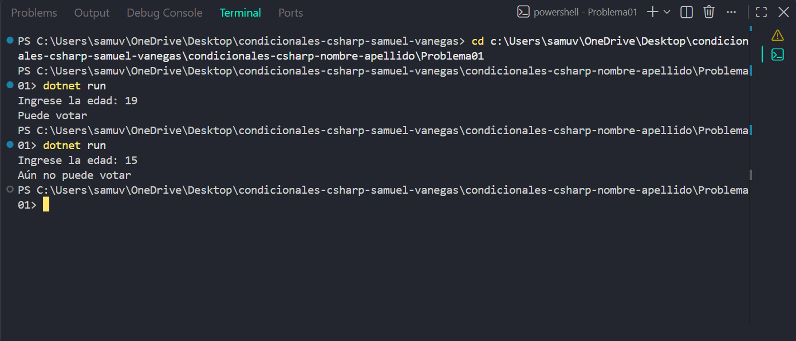

# Problema 01

## Enunciado
La Registraduría necesita un programa que reciba la edad de una persona e informe si puede votar (16 años o más en este ejercicio) o si todavía no puede hacerlo.

- Entrada: 17 → Salida: `Puede votar`
- Entrada: 15 → Salida: `Aún no puede votar`

## Estructura condicional elegida
if-else

## Justificación
permite decidir entre dos resultados según si la edad es de 16 años o más.

## Evidencia

