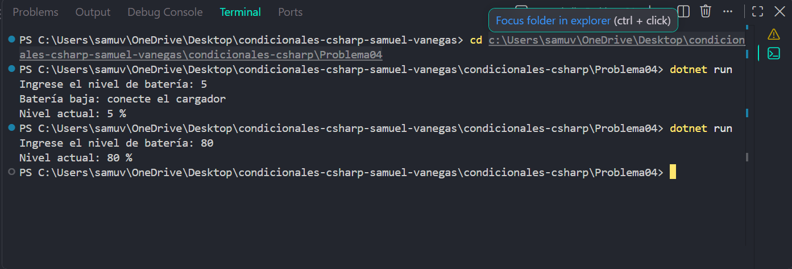

# Problema 04

## Enunciado
Una app de celular revisa el nivel de batería. Si está por debajo del 15 %, muestra `Batería baja: conecte el cargador`. En cualquier caso, al final siempre muestra `Nivel actual: X %`.

- Entrada: 10 → dos líneas: la alerta y `Nivel actual: 10 %`
- Entrada: 80 → una línea: `Nivel actual: 80 %`

## Estructura condicional elegida
if

## Justificación
la alerta solo aparece cuando la batería está por debajo del 15 %, pero el nivel siempre se muestra.

## Evidencia

