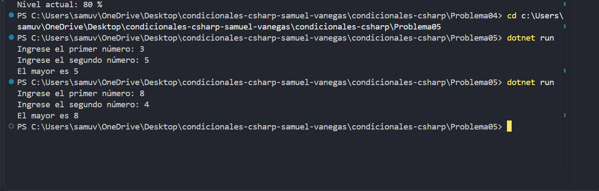

# Problema 05

## Enunciado
Dados dos números enteros, guarda en una variable `mayor` el más grande de los dos usando una sola línea de asignación, y luego imprímelo.

- Entrada: 14 y 9 → `El mayor es 14`
- Entrada: -2 y 3 → `El mayor es 3`

## Estructura condicional elegida
operador condicional ternario ?:.

## Justificación
permite asignar el mayor de los dos números en una sola línea.

## Evidencia

