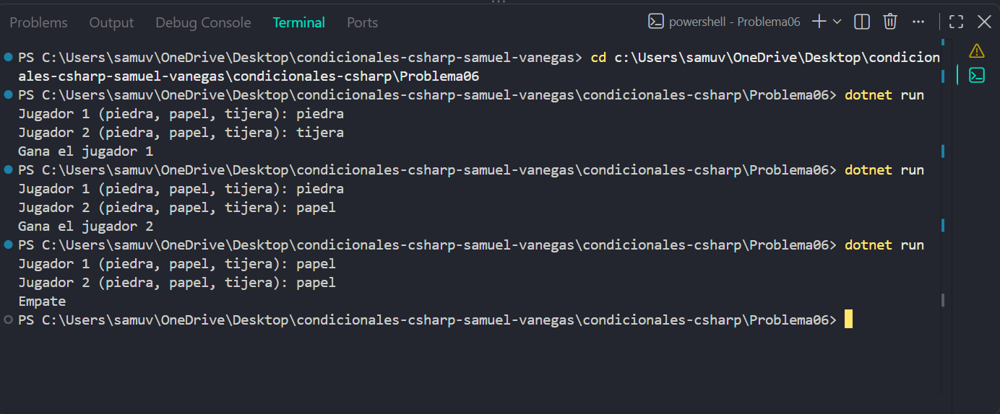

# Problema 06

## Enunciado
Dos jugadores eligen “piedra”, “papel” o “tijera”. El programa recibe ambas jugadas y determina el resultado: piedra vence a tijera, tijera vence a papel, papel vence a piedra; si son iguales es empate.

- (“piedra”, “tijera”) → `Gana el jugador 1`
- (“piedra”, “papel”) → `Gana el jugador 2`
- (“papel”, “papel”) → `Empate`

## Estructura condicional elegida
if-else else-if

## Justificación
se deben comparar las dos jugadas y evaluar las combinaciones que determinan quién gana o si hay empate.

## Evidencia

