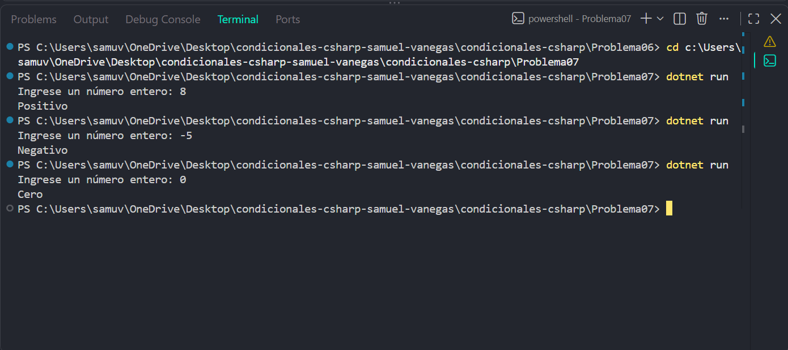

# Problema 07

## Enunciado
Lee un número entero e indica si es positivo, negativo o cero.

- 8 → `Positivo` · -5 → `Negativo` · 0 → `Cero`

## Estructura condicional elegida
if else-if

## Justificación
existen tres resultados posibles: positivo, negativo y cero

## Evidencia

