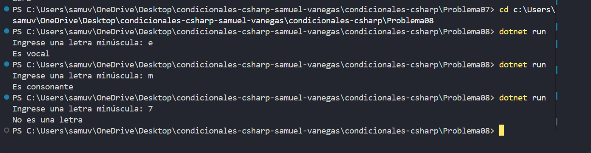

# Problema 08

## Enunciado
Lee una letra minúscula e indica si es vocal (a, e, i, o, u) o consonante. Si el carácter no es una letra del alfabeto, debe mostrar `No es una letra`.

- ‘e’ → `Es vocal` · ‘m’ → `Es consonante` · ‘7’ → `No es una letra`

## Estructura condicional elegida
if-else

## Justificación
hay que distinguir las vocales, las demás letras minúsculas del alfabeto y los caracteres que no son letras.

## Evidencia

