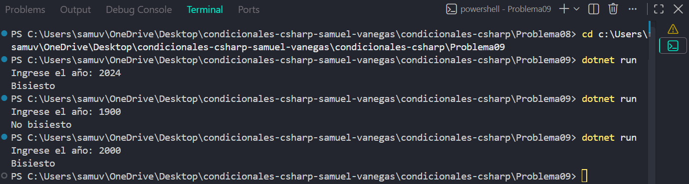

# Problema 09

## Enunciado
Un año es bisiesto si es divisible entre 4 y no entre 100, o si es divisible entre 400. Determina si un año dado es bisiesto.

- 2024 → `Bisiesto` · 1900 → `No bisiesto` · 2000 → `Bisiesto`

## Estructura condicional elegida
if-else con operadores lógicos.

## Justificación
Se utiliza if-else con operadores lógicos porque la condición de año bisiesto combina varias reglas de divisibilidad que deben cumplirse simultáneamente o como alternativa.

## Evidencia

