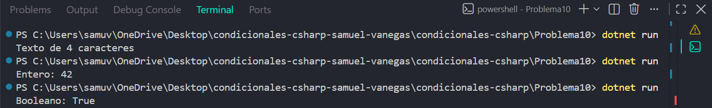

# Problema 10

## Enunciado
Un sistema recibe datos en una variable de tipo `object` que puede contener un texto, un entero, un decimal (`double`) o un valor booleano. El programa debe describir el dato:

- Texto → `Texto de N caracteres`
- Entero → `Entero: valor`
- Decimal → `Decimal: valor`
- Booleano → `Booleano: valor`
- Otro → `Tipo no reconocido`

Ejemplos: “SENA” → `Texto de 4 caracteres` · 42 → `Entero: 42` · true → `Booleano: True`

## Estructura condicional elegida
switch 

## Justificación
Se utiliza switch con patrones de tipo porque la respuesta depende del tipo de dato almacenado en una variable object, no de un único valor numérico o textual.

## Evidencia

