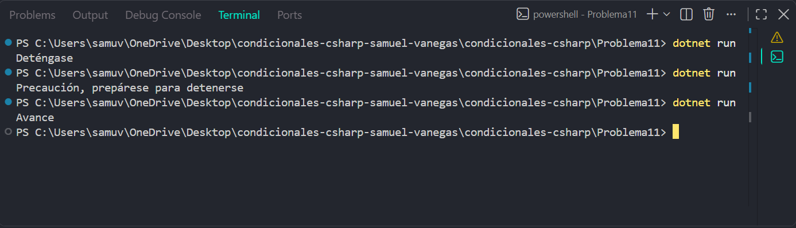

# Problema 11

## Enunciado
Define un tipo con los estados posibles de un semáforo: Rojo, Amarillo y Verde. Según el estado actual, el programa imprime la instrucción para el conductor:

- Rojo → `Deténgase`
- Amarillo → `Precaución, prepárese para detenerse`
- Verde → `Avance`

## Estructura condicional elegida
enum y switch.

## Justificación
Se utiliza enum para representar únicamente los estados definidos del semáforo y switch porque cada estado requiere una instrucción diferente.

## Evidencia

