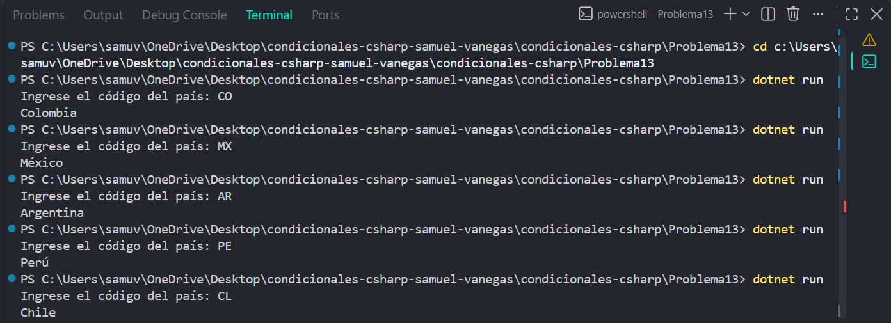

# Problema 13

## Enunciado
Un formulario web recibe un código de país de dos letras y debe guardar en una variable el nombre completo:

- “CO” → Colombia · “MX” → México · “AR” → Argentina · “PE” → Perú · “CL” → Chile
- Cualquier otro → `País no registrado`

## Estructura condicional elegida
switch

## Justificación
Se utiliza switch porque se deben comparar códigos exactos de dos letras y asignar el nombre del país correspondiente, con una respuesta predeterminada para códigos desconocidos

## Evidencia

