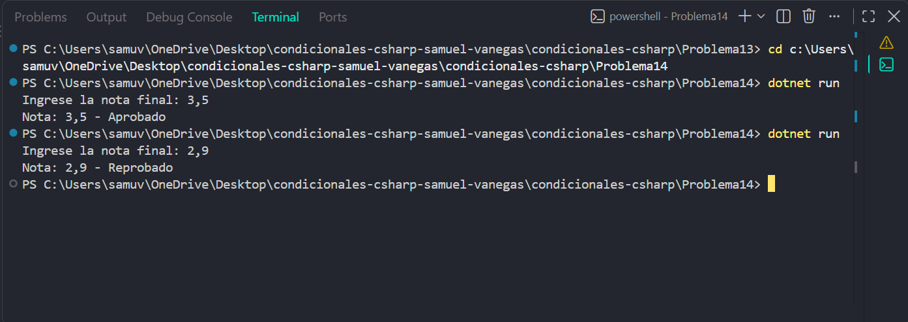

# Problema 14

## Enunciado
Dada la nota final de un aprendiz (0 a 5), guarda en una variable de texto `Aprobado` si la nota es 3,0 o más, o `Reprobado` en caso contrario, con una sola línea de asignación. Luego imprime `Nota: X - Estado`.

- 3,5 → `Nota: 3,5 - Aprobado`
- 2,9 → `Nota: 2,9 - Reprobado`

## Estructura condicional elegida
operador ternario ?:

## Justificación
Se utiliza el operador ternario porque el estado solo puede ser aprobado o reprobado según una condición, y el enunciado exige asignarlo en una sola línea.

## Evidencia

