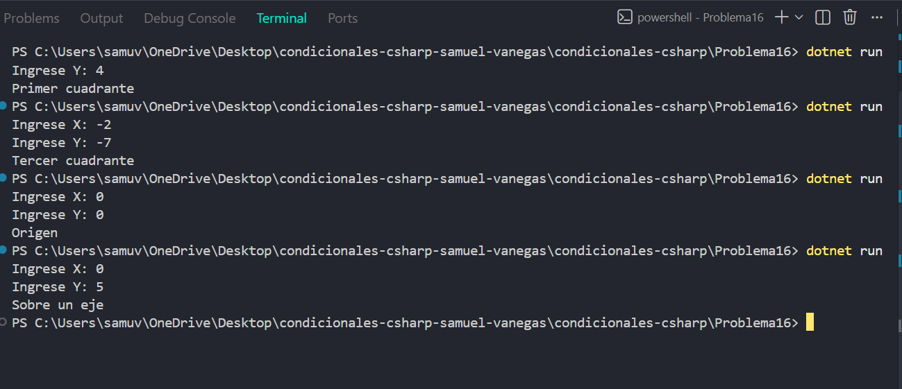

# Problema 16

## Enunciado
El centro de control recibe la posición de un dron como un par de coordenadas con nombre (X, Y). Debe informar en qué cuadrante del plano cartesiano se encuentra, si está en el origen o si está sobre uno de los ejes.

- (3, 4) → `Primer cuadrante`
- (-2, -7) → `Tercer cuadrante`
- (0, 0) → `Origen`
- (0, 5) → `Sobre un eje`

## Estructura condicional elegida
 if-else if-else con condiciones compuestas.

## Justificación
Se utiliza esta estructura porque hay que evaluar simultáneamente las coordenadas X e Y para diferenciar el origen, los ejes y los cuatro cuadrantes.

## Evidencia

