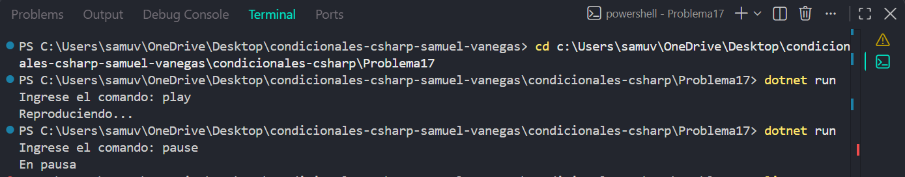

# Problema 17

## Enunciado
Un reproductor de música recibe comandos de texto: “play”, “pause”, “stop”, “next”. Cada comando imprime un mensaje distinto (Reproduciendo..., En pausa, Detenido, Siguiente canción). Un comando desconocido imprime Comando no reconocido.

## Estructura condicional elegida
 switch 
## Justificación
Se utiliza switch porque cada comando de texto representa una opción exacta que debe ejecutar una acción diferente y existe un mensaje para los comandos desconocidos.

## Evidencia

