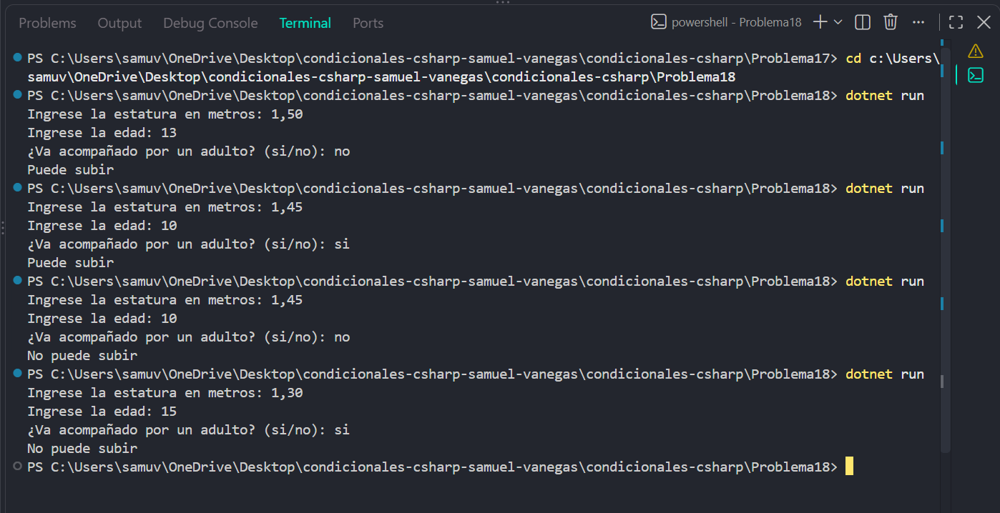

# Problema 18

## Enunciado
Para subir a la montaña rusa, una persona debe medir al menos 1,40 m y además tener 12 años o más, a menos que vaya acompañada por un adulto, en cuyo caso basta con la estatura. Determina si puede subir.

- Estatura 1,50, edad 13, sin acompañante → `Puede subir`
- Estatura 1,45, edad 10, con acompañante → `Puede subir`
- Estatura 1,45, edad 10, sin acompañante → `No puede subir`
- Estatura 1,30, edad 15, con acompañante → `No puede subir`

## Estructura condicional elegida
if-else con operadores lógicos.

## Justificación
Se utiliza if-else con operadores lógicos porque la persona debe cumplir la estatura mínima y, adicionalmente, tener la edad requerida o ir acompañada por un adulto.

## Evidencia

