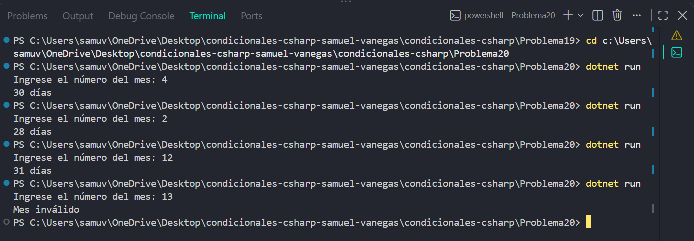

# Problema 20

## Enunciado
Dado el número de un mes (1 a 12) de un año no bisiesto, imprime cuántos días tiene. Varios meses comparten la misma cantidad de días. Un número fuera de rango imprime `Mes inválido`.

- 4 → `30 días` · 2 → `28 días` · 12 → `31 días` · 13 → `Mes inválido`

## Estructura condicional elegida
switch con casos agrupados

## Justificación
Se utiliza switch con casos agrupados porque varios meses tienen la misma cantidad de días y pueden compartir una respuesta sin repetir instrucciones.

## Evidencia

