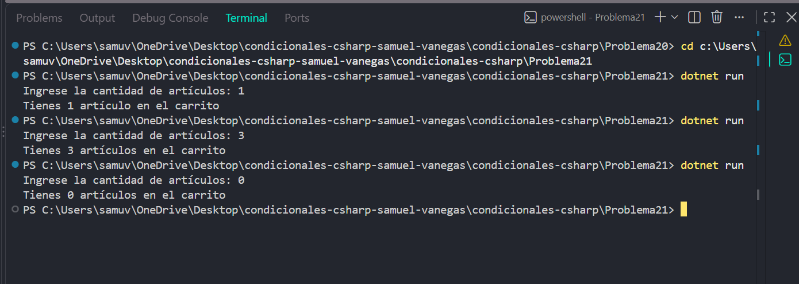

# Problema 21

## Enunciado
La tienda virtual muestra cuántos artículos hay en el carrito. La palabra debe ir en singular si hay exactamente uno y en plural en cualquier otro caso. Construye el mensaje con una sola línea de asignación.

- 1 → `Tienes 1 artículo en el carrito`
- 3 → `Tienes 3 artículos en el carrito`
- 0 → `Tienes 0 artículos en el carrito`

## Estructura condicional elegida
operador ternario ?:

## Justificación
: Se utiliza el operador ternario porque permite decidir entre singular y plural según la cantidad de artículos y construir el mensaje en una sola asignación.

## Evidencia

