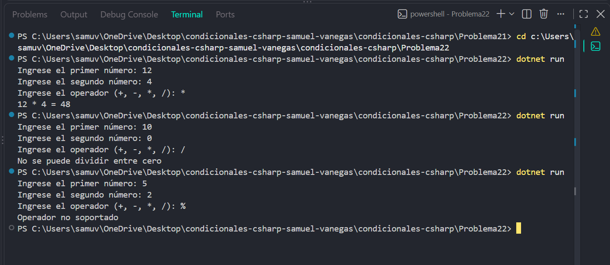

# Problema 22

## Enunciado
Recibe dos números enteros y un operador (`+`, `-`, `*`, `/`) y guarda el resultado de la operación en una variable. Si se intenta dividir entre cero, el programa debe lanzar una excepción con el mensaje `No se puede dividir entre cero`. Si el operador no es válido, debe lanzar una excepción con el mensaje `Operador no soportado`.

- 12, 4, ‘*’ → `12 * 4 = 48`
- 10, 0, ‘/’ → excepción `No se puede dividir entre cero`
- 5, 2, ‘%’ → excepción `Operador no soportado`

## Estructura condicional elegida
switch con excepciones.

## Justificación
: Se utiliza switch porque cada operador representa una operación específica, y las excepciones permiten comunicar los errores que exige el enunciado cuando la división es entre cero o el operador no está soportado.

## Evidencia

