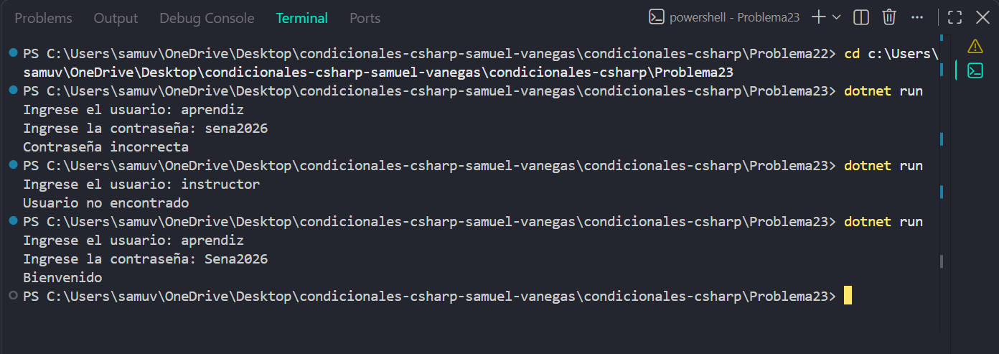

# Problema 23

## Enunciado
Un sistema valida el acceso en dos pasos. Primero verifica que el usuario exista (el único usuario registrado es “aprendiz”). Si no existe, muestra Usuario no encontrado. Si existe, verifica la contraseña (“Sena2026”): si es correcta muestra Bienvenido; si no, muestra Contraseña incorrecta. Cada error debe tener su propio mensaje.

## Estructura condicional elegida
if-else anidado

## Justificación
Se utiliza un if-else anidado porque la contraseña solo debe comprobarse después de confirmar que el usuario existe, permitiendo mostrar un mensaje diferente para cada error.

## Evidencia

