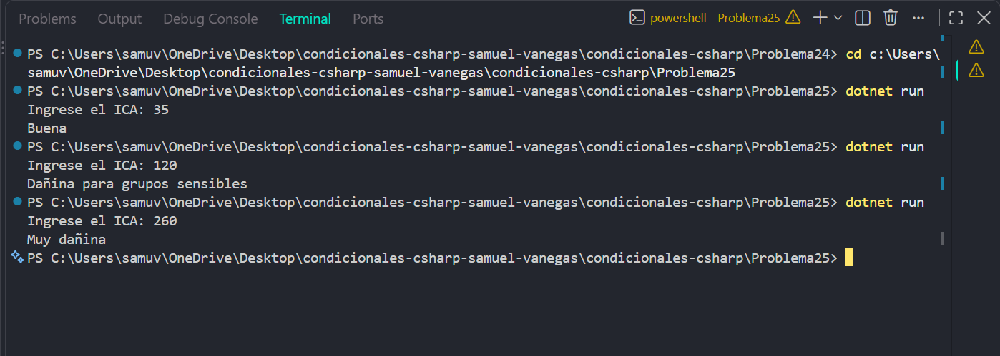

# Problema 25

## Enunciado
Una estación de monitoreo recibe el índice de calidad del aire (ICA, entero) y debe asignar la categoría:

- 0 a 50: Buena
- 51 a 100: Moderada
- 101 a 150: Dañina para grupos sensibles
- 151 a 200: Dañina
- Más de 200: Muy dañina
- Negativo: Valor inválido

Ejemplos: 35 → `Buena` · 120 → `Dañina para grupos sensibles` · 260 → `Muy dañina`

## Estructura condicional elegida
if-else if-else

## Justificación
Se utiliza if-else if-else porque el índice de calidad del aire se
clasifica en distintos intervalos numéricos, además de contemplar los valores
negativos como inválidos.

## Evidencia

