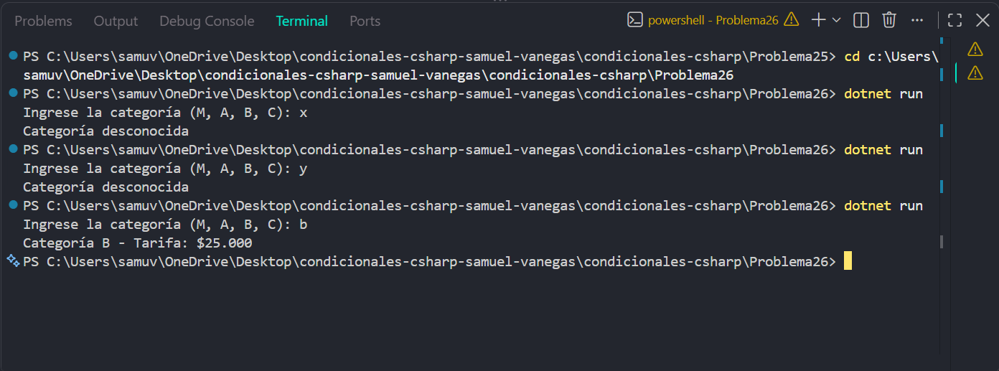

# Problema 26

## Enunciado
Un peaje identifica el vehículo con una letra y asigna la tarifa a cobrar:

- ‘M’ moto: $0 (exenta)
- ‘A’ automóvil: $12.000
- ‘B’ bus: $25.000
- ‘C’ camión: $38.000
- Otra letra: se lanza una excepción con el mensaje `Categoría desconocida`

Imprime `Categoría X - Tarifa: $Y`.

## Estructura condicional elegida
switch con excepción.

## Justificación
Se utiliza switch porque cada letra identifica una categoría de
vehículo con una tarifa fija, mientras que una categoría desconocida debe
generar la excepción indicada.

## Evidencia

