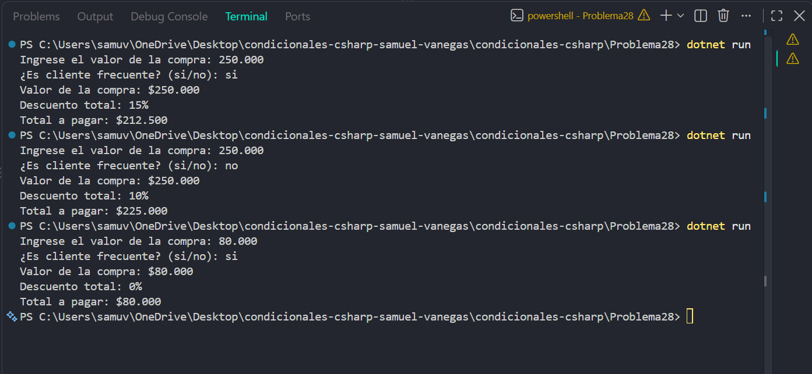

# Problema 28

## Enunciado
Un almacén aplica descuentos según el valor de la compra:
$500.000 o más: 15 %
$200.000 a menos de $500.000: 10 %
$100.000 a menos de $200.000: 5 %
Menos de $100.000: sin descuento
Además, si el cliente está inscrito en el programa de cliente frecuente y la compra
es de $100.000 o más, recibe un 5 % adicional. El programa muestra el valor de la
compra, el porcentaje total de descuento y el total a pagar.
$250.000, frecuente → descuento 15 %, total $212.500
$250.000, no frecuente → descuento 10 %, total $225.000
$80.000, frecuente → descuento 0 %, total $80.000

## Estructura condicional elegida
if-else if-else con condiciones compuestas.

## Justificación
Se utiliza esta estructura porque el descuento base depende del
rango del valor de compra y luego se debe comprobar una condición adicional
para sumar el descuento de cliente frecuente

## Evidencia

