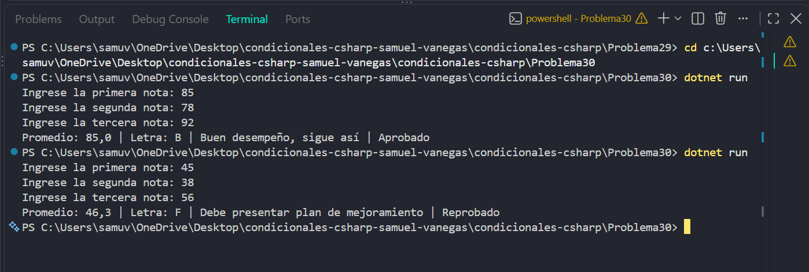

# Problema 30

## Enunciado
Un instructor registra tres notas de un aprendiz (0 a 100). El programa debe:
1. Calcular el promedio.
2. Convertir el promedio a letra: 90 o más → A, 80 a 89 → B, 70 a 79 → C, 60 a
69 → D, menos de 60 → F.
3. Según la letra, imprimir un mensaje de retroalimentación: A → Desempeño
excelente ; B o C → Buen desempeño, sigue así ; D → Aprobado, refuerza los temas ; F →
Debe presentar plan de mejoramiento .
4. Indicar Aprobado o Reprobado (aprueba con 60 o más).
5. Si el promedio es exactamente 100, mostrar adicionalmente ¡Mención de honor! .
Ejemplo: notas 85, 78, 92 → Promedio: 85,0 | Letra: B | Buen desempeño, sigue así |
Aprobado

## Estructura condicional elegida
if-else if-else y operador ternario

## Justificación
Se utiliza if-else if-else porque el promedio se debe clasificar en
varios rangos para determinar la letra y la retroalimentación; el operador ternario
permite decidir si el aprendiz está aprobado o reprobado

## Evidencia

